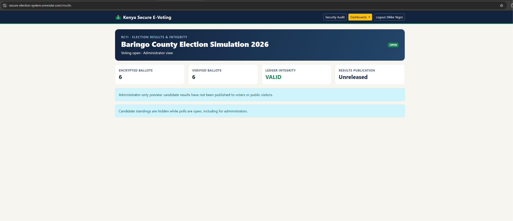

# Secure Electronic Voting System
### MSc Computer Science (Cybersecurity) — Technical Portfolio

**Author:** Micah K. Yego  
**Project Type:** MSc Dissertation / Cybersecurity Research Prototype  
**Focus:** Secure Application Development, Cryptography, Authentication, Access Control and Security Auditing

---

## 1. Project Overview

This project explores the design, development and security evaluation of a web-based electronic voting system, with particular consideration for election administration in developing countries.

The application was developed as part of my MSc Computer Science studies, specialising in Cybersecurity.

The project demonstrates how cryptographic techniques, authentication mechanisms, database security controls and audit procedures can be incorporated into an electronic voting prototype.

**Live Demonstration:**  
https://secure-election-system.onrender.com

**Important:** This application is an academic research prototype and is not intended for use in real elections.

---

## 2. Project Objectives

The primary objectives were to:

- Design and develop a functional electronic voting prototype.
- Implement voter registration and email verification.
- Apply cryptographic protection to stored ballots.
- Prevent duplicate voting.
- Implement role-based access control for administrators and voters.
- Develop security auditing and ballot integrity verification mechanisms.
- Evaluate selected security controls through practical testing.
- Deploy the application to a cloud-hosted environment.

---

## 3. Technology Stack

| Component | Technology |
|---|---|
| Programming language | Python |
| Web framework | Flask |
| Database | PostgreSQL |
| Ballot encryption | Fernet symmetric encryption |
| Integrity verification | SHA-256 hash chaining |
| Authentication | Session-based authentication and email verification |
| Access control | Role-based access control |
| Deployment | Render |
| Version control | GitHub |

---

## 4. Security Architecture

The application incorporates several security mechanisms.

### 4.1 Authentication and Voter Verification

The system uses account authentication and email verification to support voter registration and access control.

### 4.2 Ballot Encryption

Recorded ballots are protected using Fernet authenticated encryption.

This helps protect ballot contents stored within the application database.

### 4.3 Ballot Integrity Verification

The application implements a SHA-256-based hash chain to support detection of unauthorised changes to recorded ballot data.

An integrity verification function checks the stored chain and reports detected inconsistencies.

### 4.4 Duplicate-Voting Prevention

The voting workflow includes controls designed to prevent repeated ballot submissions by the same voter.

### 4.5 Role-Based Access Control

Different application roles provide separation between voter functions and administrative responsibilities.

### 4.6 Security Audit Logging

The application records security-relevant events to support administrative review and investigation.

---

## 5. Security Testing and Evaluation

Selected security controls were evaluated using controlled tests.

| Security test | Purpose | Observed outcome |
|---|---|---|
| Duplicate-voting test | Check prevention of repeated voting | Passed in local testing |
| Concurrent submission test | Evaluate simultaneous voting requests | Passed in local testing |
| Hash-chain verification | Check integrity of recorded ballots | Passed in local testing |
| Controlled ballot tampering | Evaluate detection of modified records | Tampering detected in local testing |
| Results-page integrity reporting | Check visibility of integrity failures | Failure reported in local testing |

These outcomes describe the tests performed on the academic prototype. They do not constitute a comprehensive independent security audit or certification.

---

## 6. Deployment Architecture

The demonstration system uses:

- Flask for application processing.
- PostgreSQL for persistent data storage.
- Render for cloud deployment.
- GitHub for version control and deployment integration.

Separate staging and production environments were used during development and testing.

---

## 7. Cybersecurity Skills Demonstrated

This project provided practical experience in:

- Secure application development.
- Authentication and access control.
- Applied cryptography.
- Database security concepts.
- Security testing and validation.
- Integrity monitoring.
- Security audit analysis.
- Python application development.
- Cloud deployment and troubleshooting.

These skills are relevant to entry-level cybersecurity, security operations and application security roles.

---

## 8. Project Limitations

The system is an academic prototype rather than a certified election platform.

Cryptographic protection and hash-chain verification alone do not establish end-to-end verifiability, coercion resistance, voter anonymity or the security guarantees required for public elections.

Further independent security assessment, privacy evaluation and specialised election-security controls would be required before considering any real-world electoral application.

---

## 9. Source Code Availability

The application source code is maintained in a private repository for security and intellectual property protection.

This public repository is intended to provide technical documentation, architecture descriptions, selected screenshots and security testing evidence without disclosing sensitive application details.

---

## 10. Author

**Micah K. Yego**  
MSc Computer Science (Cybersecurity)

**Career Interests:** SOC Analyst, Cybersecurity Analyst, IT Security Technician and Secure Application Development.

**GitHub:** https://github.com/MikeKips2020
---

## Security Testing Evidence and SOC Investigation

The following documents and screenshots demonstrate selected
cybersecurity controls implemented and evaluated during my
MSc Secure Electronic Voting System project.

### Technical Documentation

- [System Architecture](SYSTEM_ARCHITECTURE.md)
- [Security Testing and Evaluation Report](SECURITY_TESTING_REPORT.md)
- [SOC Analyst Investigation Report](SOC_ANALYST_INVESTIGATION.md)

### Security Evidence

**1. Security Audit Dashboard — Illustrative View**

Illustrative dashboard image showing security monitoring and
audit logging functionality. This is a reconstructed visual,
not original security-testing evidence.

**2. Ballot Integrity Verification — Live System Evidence**

Screenshot from the deployed academic prototype showing:

- Six encrypted ballots.
- Six verified ballots.
- Ledger integrity reported as VALID.
- Election results remaining unreleased.

The screenshot records the application's reported verification
status at the time of capture. It does not constitute an
independent security certification.

### Cybersecurity Skills Demonstrated

- Security event monitoring and investigation.
- Role-based access control.
- Cryptographic ballot protection.
- SHA-256 hash-chain integrity verification.
- Security testing and incident documentation.
- Python, Flask and PostgreSQL.
